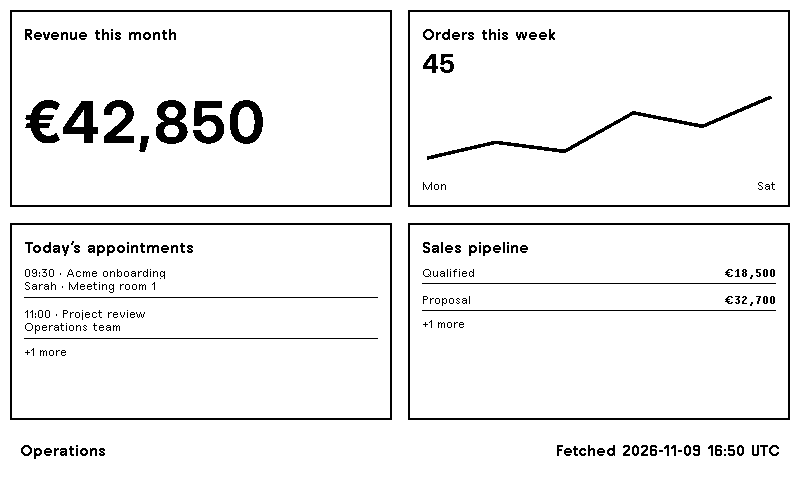

# Clawnify for TRMNL

Put your app's metrics, charts and lists on a [TRMNL](https://trmnl.com) e-paper display.

A native TRMNL plugin built with Liquid and a JavaScript transform. TRMNL handles polling and rendering; you do not need to host a separate service for the plugin.



**Status:** The plugin can be previewed and tested locally with the included sample data. The Clawnify display-connection feature is awaiting deployment. Live account and physical-device verification are pending; this is not yet a listed TRMNL recipe.

## What it displays

Choose up to four dashboard widgets from one published Clawnify app:

- A metric, such as revenue, open tickets or occupancy.
- A trend, such as orders per day.
- A breakdown, such as your sales pipeline.
- A list, such as today's appointments.

| Layout | Tiles shown |
| --- | --- |
| Full | First four selected tiles |
| Half horizontal | First two |
| Half vertical | First two |
| Quadrant | First one |

Lists and breakdowns show their first two entries and a count of remaining entries. A footer shows when Clawnify fetched the data, in UTC; it is not the time the underlying records last changed. Smaller layouts use `MM-DD HH:MMZ` and show a `+N` count for hidden tiles.

This is a read-only view of app data. Interactive controls and arbitrary web pages are not captured. An app must expose dashboard widgets before it can be connected.

## Setup

Live setup requires the **Display on TRMNL** button to be available in your Clawnify app. Until then, use the sample preview below.

1. In the published Clawnify app, open **Display on TRMNL**, choose the tiles to share and select **Create connection**. Copy its display key before closing the dialog.
2. Build the import file from this repo with `npm run package` (requires Python 3). In TRMNL, import `_build/clawnify-trmnl-plugin.zip` as a [Private Plugin](https://help.trmnl.com/en/articles/10542599-importing-and-exporting-private-plugins).
3. Paste the key into the plugin's **Display key** field, then add the plugin to a playlist. The settings request a 15-minute refresh interval; TRMNL's account and device settings control when updates actually reach the display.

To choose different tiles or replace a lost key, open the same Clawnify dialog and select **Replace connection**, then paste the new key into TRMNL. To stop updates, select **Disconnect**. One person has one connection per app; multiple devices can share it, and replacement or disconnection affects all copies.

## Privacy and access

TRMNL receives the selected app data and stores the display key. Share only information you want displayed there.

The display key can only read the selected widgets from that app. It is separate from a Clawnify login or personal access token, travels in the Authorization header, and is stored as a hash in Clawnify. Clawnify rechecks the connecting person's access for each poll. Leaving the workspace suspends reads; rejoining can resume an existing connection. Explicitly disconnect a key to revoke it permanently. Signing out of Clawnify does not disconnect a display. Keys do not belong in URLs, source files, screenshots, issues or commits.

A failed fetch may leave an older image on the device. An error response that reaches the template shows **Display unavailable**. Revoking access stops future reads; it cannot erase an image already downloaded or displayed. Check the fetched timestamp before acting on time-sensitive information.

## Local development

Requires Node.js 22+, Python 3 and Docker. No account or API key is needed for the sample preview.

```sh
git clone https://github.com/clawnify/clawnify-trmnl-plugin.git
cd clawnify-trmnl-plugin
npm test
bin/trmnlp lint
bin/trmnlp test --report _build/report
bin/trmnlp serve
```

Open [localhost:4567](http://localhost:4567). The wrapper generates a gitignored `.trmnlp.yml` from `preview/sample.json` and disables polling for this sample. It uses a pinned official [trmnlp](https://github.com/usetrmnl/trmnlp) Docker image. Run `python3 bin/sample-config.py` after changing the sample.

The Ruby tests exercise the real polling/transform/Liquid/browser pipeline with mocked app responses. Node tests check transformation boundaries. CI runs both and uploads the report and import ZIP; it does not publish a recipe or need credentials.

```text
src/settings.yml       Polling endpoint and display-key form
src/transform.js       Bounded data formatting; no credentials in output
src/shared.liquid      Shared tiles and footer
src/*.liquid           Four TRMNL layouts
preview/sample.json    Fictional data used by previews and tests
bin/package.py         Flat ZIP import, with an explicit file allowlist
```

To regenerate the README image, run `bin/trmnlp build --png` and copy `_build/full.png` to `preview/full.png`.

## Feed contract

The plugin requests `GET https://provision.clawnify.com/displays/trmnl` with `Accept: application/json` and `Authorization: Bearer <display-key>`. The response is versioned:

```json
{
  "version": 1,
  "name": "Operations",
  "fetched_at": "2026-11-09T16:50:00.000Z",
  "widgets": [
    { "key": "revenue", "kind": "metric", "title": "Revenue", "value": 42850, "format": "currency", "currency": "EUR" }
  ]
}
```

Supported kinds are `metric`, `series` (`points: [{x, y}]`), `breakdown` (`items: [{label, value}]`) and `list` (`items: [{label, meta?}]`). Numeric formats are `number`, `currency` and `percent`; percentages are fractions (`0.42` renders as `42%`). A response containing `error` produces an unavailable screen, with no partial data. Unknown contract versions are rejected. See `preview/sample.json` for all four kinds.

## Credits and license

[Resend's TRMNL plugin](https://github.com/resend/resend-trmnl-plugin) was the reference for the native plugin packaging. This plugin's implementation is original and uses TRMNL's framework and preview tools.

[MIT](LICENSE).
